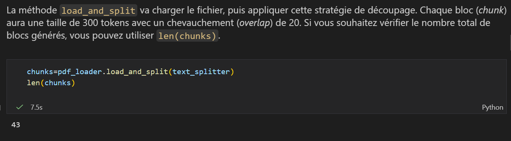
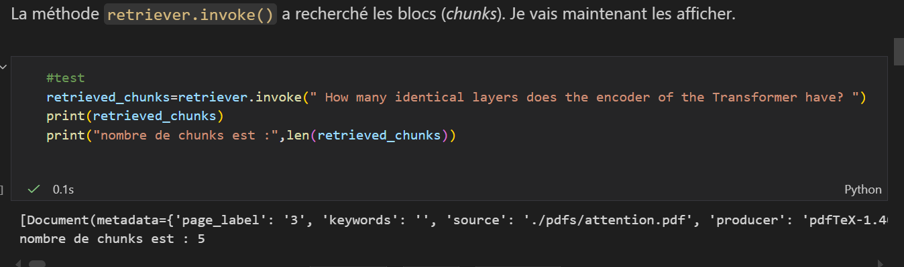
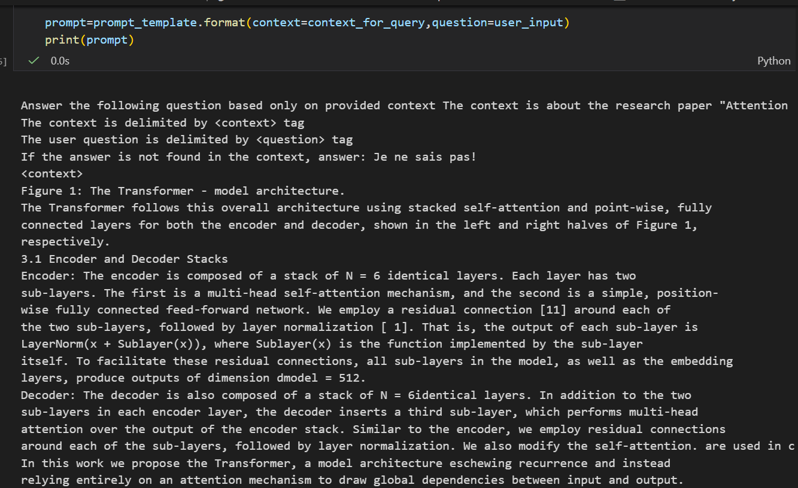
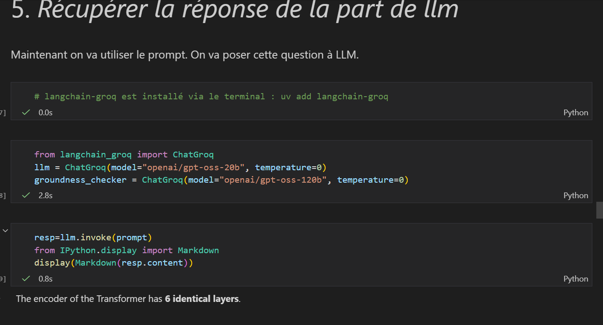
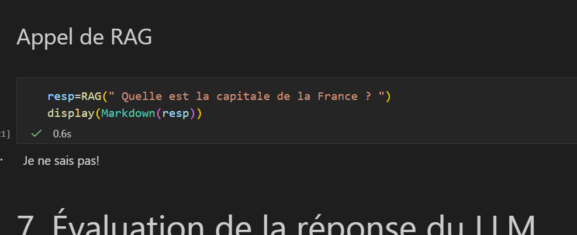
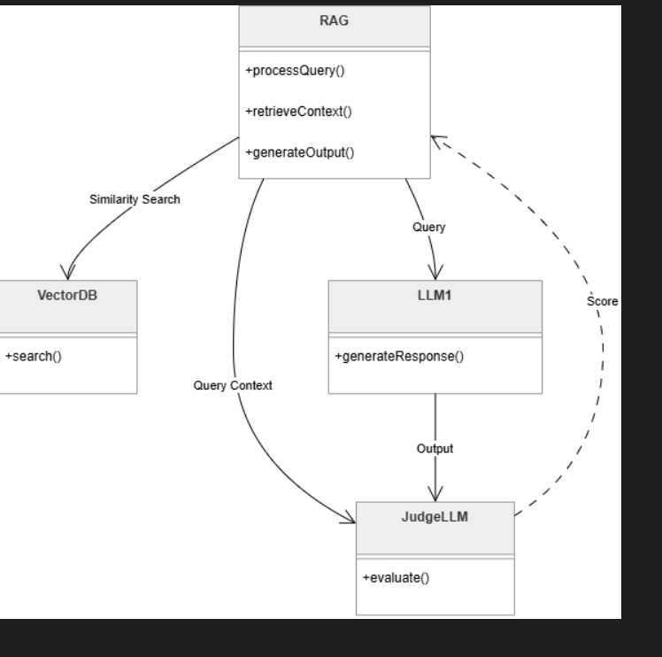
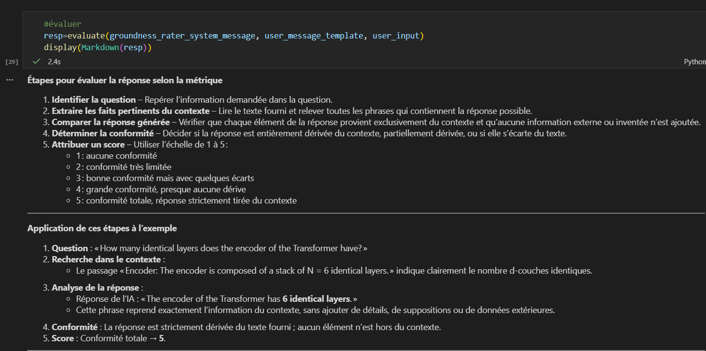
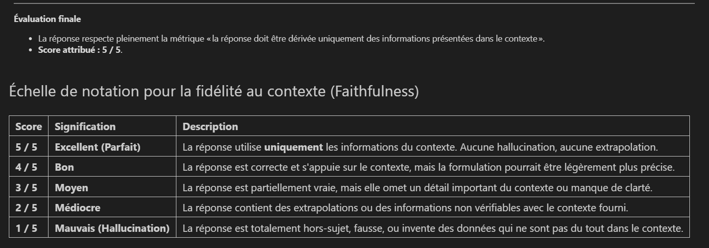

# TP4 — Implémentation d'un système RAG : réponses et résultats

**Étudiant(e) :** Fatima-ezzahra AMARZOUG — Master AIDC, FST Béni Mellal (USMS)
**Document utilisé :** *Attention Is All You Need* (`pdfs/attention.pdf`, 15 pages)
**Pile technique :** LangChain, ChromaDB, embeddings HuggingFace `paraphrase-multilingual-MiniLM-L12-v2`, LLM Groq `openai/gpt-oss-20b`, juge `openai/gpt-oss-120b`, environnement géré avec `uv`.

## 1. Chargement et découpage du PDF

Le PDF est chargé avec `PyPDFLoader`, puis découpé avec `RecursiveCharacterTextSplitter` (encodeur `tiktoken` `o200k_base`, blocs de **300 tokens**, chevauchement de **20 tokens**).

**Résultat : 43 chunks.**

## 2. Vectorisation et recherche (retriever)

Les chunks sont vectorisés avec le modèle d'embedding HuggingFace multilingue et stockés dans ChromaDB (collection `attention_hf`, dossier `./store`). Le retriever utilise la similarité avec `k = 5`.

Pour la question : *« How many identical layers does the encoder of the Transformer have? »*, il renvoie **5 chunks**. Le premier contient la phrase : *« The encoder is composed of a stack of N = 6 identical layers »*.

## 3. Conception du prompt

Le prompt contient trois éléments : une consigne système (répondre uniquement à partir du contexte, sinon répondre « Je ne sais pas! »), le contexte entre les balises `<context>` et la question entre les balises `<question>`. Le contexte est la concaténation des 5 chunks récupérés.

## 4. Réponse du LLM

Le LLM, appelé avec ce prompt, répond : **« The encoder of the Transformer has 6 identical layers. »** Cette réponse est correcte et correspond au texte de l'article.

## 5. Fonction RAG et gestion des hallucinations

La fonction `RAG(query)` regroupe le retrieval, la construction du prompt et l'appel au LLM. Pour tester le comportement hors contexte, on pose la question *« Quelle est la capitale de la France ? »*, absente de l'article.

**Résultat : « Je ne sais pas! »**. Le système refuse de répondre avec ses connaissances propres, ce qui limite les hallucinations.

## 6. Évaluation de la réponse (LLM-as-a-judge)

L'architecture d'évaluation est la suivante : le RAG interroge la base vectorielle, le LLM1 génère la réponse, puis un second LLM (le juge, plus puissant) évalue la réponse à partir de la question, du contexte et de la réponse.

La métrique utilisée est la **fidélité au contexte (groundedness)** : la réponse doit être dérivée uniquement des informations du contexte, avec une note de 1 à 5.

Le juge identifie la phrase *« Encoder: The encoder is composed of a stack of N = 6 identical layers »* dans le contexte et constate que la réponse la reprend sans ajout d'information extérieure.

**Score attribué : 5 / 5** (conformité totale au contexte, aucune hallucination).

## 7. Conclusion

| Étape | Résultat |
| :--- | :--- |
| Découpage | 43 chunks (300 tokens, overlap 20) |
| Retrieval | 5 chunks, dont celui contenant la réponse |
| Réponse du RAG | 6 couches identiques (correct) |
| Question hors contexte | « Je ne sais pas! » |
| Évaluation du juge | 5 / 5 |

**Remarque :** une première question sur le nombre de têtes d'attention (réponse : 8) a montré une limite du retrieval. Avec `k = 5` et des chunks de 300 tokens, le passage de la section 3.2.2 n'était pas dans les chunks récupérés, donc le LLM ne pouvait pas y répondre. La qualité d'un RAG dépend donc directement du retrieval (taille des chunks, valeur de `k`, qualité de l'embedding).
